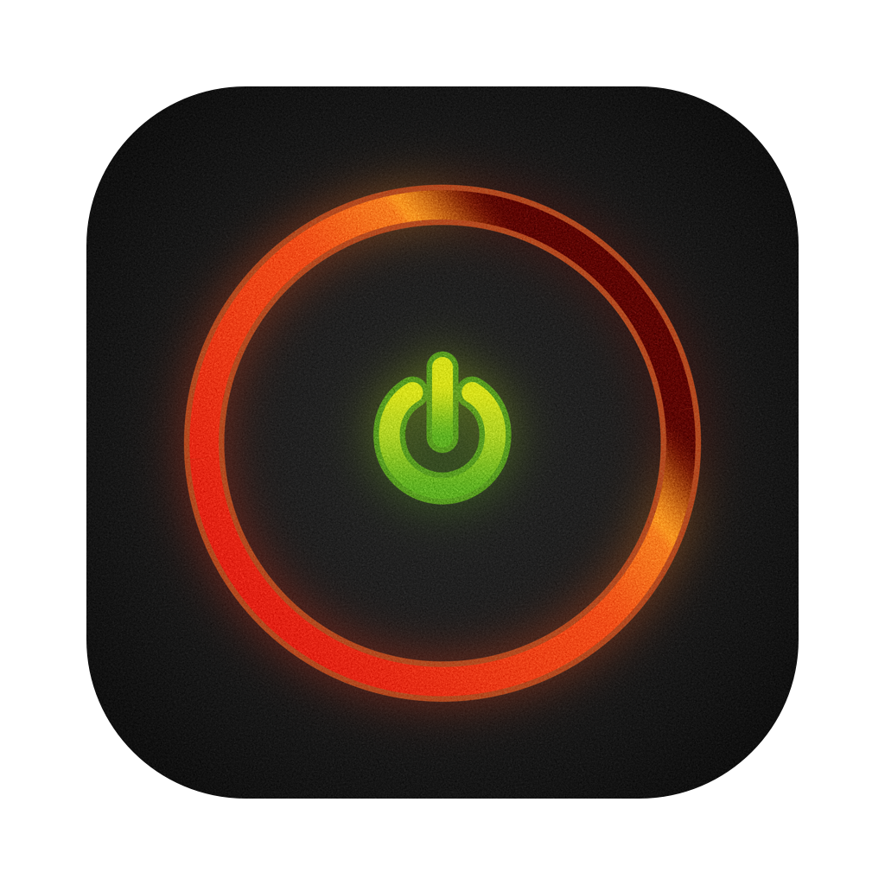

    

<h1 align="center">macXenos</h1>

An Xbox 360 emulator for the Mac.

macXenos is an unofficial macOS fork and port of
[Xenia Canary](https://github.com/xenia-canary/xenia-canary), with a few
tweaks from [Xenia Edge](https://github.com/has207/xenia-edge). Most of the
emulator is Canary. The work here is about making it run well on a Mac.

The foundational research and discovery belong to the Xenia, Xenia Canary
and Xenia Edge contributors. This project covers only the Mac-specific work.

Website and downloads: [macxenos.com](https://macxenos.com)

## About the name

Out of respect for the Xenia projects, the name is related to Xenia. Xenia
is the Greek idea of hospitality to strangers, likely a play on *xenos*,
which means "stranger" or "foreigner". Xenos is also the codename of the
GPU inside the Xbox 360. This port is mostly about the graphics side, hence
macXenos.

## What's different on the Mac

- **A native Metal renderer.** macXenos draws the game directly with Metal,
  Apple's graphics API, ported from Xenia Canary and Edge with a focus on
  stability, compatibility, performance and power use.
- **Upscaling.** AMD FSR and MetalFX can upscale the picture to your window
  or display.
- **Internal resolution scaling.** Games can render at a higher resolution
  than the Xbox 360 did.
- **A Mac app.** A signed, universal app with a game library, settings,
  player profiles and an in-game dashboard, plus automatic updates.
- **Frame generation through Metal 4** is planned.

The Vulkan renderer (through MoltenVK) is still included as a fallback.

## Requirements

- macOS 15 Sequoia or later
- A Mac with Apple silicon (Intel Macs work on a best-effort basis)
- About 2 to 3 GB of free memory while a game runs
- A game controller
- Xbox 360 games

## Getting started

1. Download the latest build from [macxenos.com](https://macxenos.com) and
   drag macXenos to your Applications folder.
2. Open it and point it at the folder that holds your games, or use
   File > Open to start one directly.
3. Plug in or pair a controller. Most controllers that macOS recognizes work
   without setup.

The first time you play a game, it will stutter for a while as it builds its
shaders. Later runs are smoother.

Settings, saves and the log are kept in `~/.local/share/Xenia`.

The [user guide](docs/user_guide.md) covers the dashboard, controllers,
graphics settings and more.

## Game compatibility

Many games run well, and some do not run at all yet. The
[compatibility list](docs/compatibility.md) shows the games macXenos is
tested with regularly, how far each test goes and the frame rate on an M4
Mac mini. The community
[compatibility list](https://xenia-manager.github.io/compatibility) tracks
Xenia as a whole; results on the Mac can differ.

## Reporting problems

See [Troubleshooting](docs/troubleshooting.md) for common problems and what
to include in a report. Please report problems with macXenos to this project,
not to the Xenia Canary or Xenia Edge projects.

## Building from source

See [Building macXenos](docs/building.md). macXenos builds on macOS only.
Engineering notes for the Metal renderer are in the
[developer documentation](docs/dev/README.md).

## Credits

- [Xenia](https://github.com/xenia-project/xenia) and
  [Xenia Canary](https://github.com/xenia-canary/xenia-canary), which this
  project is built on
- [Xenia Edge](https://github.com/has207/xenia-edge), for several fixes
  and ideas
- Third-party libraries are listed in the app under System > About >
  Acknowledgements

## License

macXenos is released under the same BSD license as Xenia. See
[LICENSE](LICENSE).

## Disclaimer

macXenos is not affiliated with the Xenia projects, Microsoft or Apple.

This project is for research, experimentation and learning about emulation.
**It is not for enabling illegal activity.** Use your own games. All
information comes from reverse engineering legally purchased hardware and
games, and from material that is publicly available.
